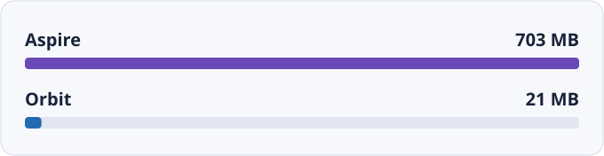
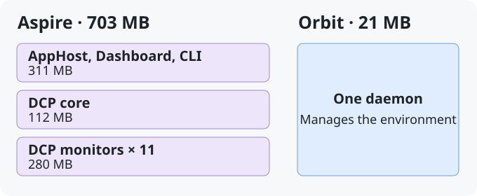

# Benchmarks

[English](./benchmarks.md) · [繁體中文](./benchmarks.zh-TW.md)

In one macOS run of the eShop sample, Orbit's daemon had a measured memory
footprint of **21 MB**, compared with **703 MB** across Aspire's tooling
processes. That is about **97% lower** for Orbit in this run.
[dotnet/eShop reference application](https://github.com/dotnet/eShop)

## Tooling processes

Aspire runs its application model, dashboard, and resource management in
separate processes. In this eShop run, the DCP core and its 11 monitors
accounted for **392 MB**, about **56%** of the tooling footprint. Orbit's
daemon manages local services and containers and serves the dashboard and API.
The boxes show process roles. Their labels show measured memory.

::: details Measurement notes

The comparison uses macOS `phys_footprint` for the orchestration processes.
Aspire's total includes its CLI, AppHost, Dashboard, DCP processes, and DCP
watchdogs. Orbit's total covers its daemon. Both totals exclude application
services and databases.

The October 2026 measurement record provides one observation. It does not
include the exact commands, sampling window, or confirmed hardware and tool
versions for this memory run. The result describes the tooling footprint for
this setup. The full stack's memory use, memory available to other workloads,
and results on CI runners would require separate measurements.

:::
