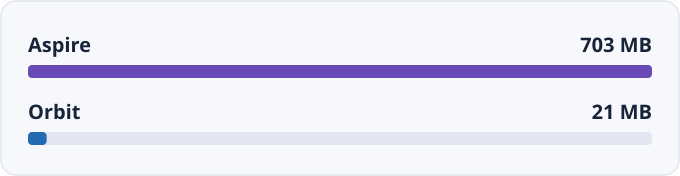
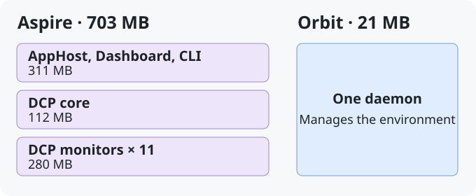

# 效能實測

[English](./benchmarks.md) · [繁體中文](./benchmarks.zh-TW.md)

在 macOS 上執行 eShop 範例的一次量測中，Orbit daemon 的記憶體占用為
**21 MB**，Aspire 的工具程序合計為 **703 MB**。在這次量測中，Orbit 的
工具記憶體占用約低 **97%**。
[dotnet/eShop 參考應用程式](https://github.com/dotnet/eShop)

## 管理程序

Aspire 把應用模型、Dashboard 和資源管理拆成多個程序。在這次 eShop 量測中，
DCP 主程序和 11 個監控程序合計 **392 MB**，約占工具用量的 **56%**。
Orbit 由一個 daemon 管理本機服務與容器，並提供 Dashboard 和 API。
圖中的方塊代表程序分工，記憶體用量以標示的數字為準。

::: details 量測補充

這次比較採用 macOS 的 `phys_footprint` 指標，統計協調工具的程序。
Aspire 的總量包含 CLI、AppHost、Dashboard、DCP 程序與 DCP watchdog；
Orbit 的總量則來自 daemon。兩邊都排除了應用程式服務與資料庫。

2026 年 10 月的紀錄只有一次觀測，未提供這次記憶體量測的確切指令、取樣區間、
已確認的硬體規格或工具版本。這個結果反映當次環境中的工具記憶體占用。
整套環境的用量、可供其他工作使用的記憶體，以及 CI runner 上的結果，都需要另外量測。

:::
