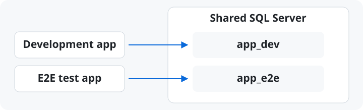

# E2E Testing

[English](./e2e-testing.md) · [繁體中文](./e2e-testing.zh-TW.md)

Use Orbit to start the database, cache, and broker for E2E tests. The test
harness prepares its own data and checks the environment before running.

## Infrastructure and Test Data

Split the stack into three layers with different owners:

| Layer | Owner | Lifetime |
|---|---|---|
| Infrastructure (database, cache, broker) | Orbit (`orbit up --infra`) | long-lived, shared with everyday dev |
| Test data (a dedicated database or schema) | the test harness | disposable, reset between scenarios |
| System under test (the app runtime) | the test harness | started per run with a test profile |

### Database Isolation



Point the development app at `app_dev` and the test profile at `app_e2e`.
Set the database name in each app's connection configuration. If you use a
SQL Project, configure `app_e2e` as a publish target, run
`orbit sqlserver publish app_e2e`, then seed the test data. Before resetting,
abort unless the resolved database is `app_e2e`. Use separate listen ports when both apps run side by side.

See [SQL Projects](sql-workflow.md) for how to publish a
local SQL Project.

## Readiness Checks

`orbit switch` stops running resources and restarts the daemon. It is a
machine-wide provisioning step: correct in a pipeline's setup stage or typed
by a person, wrong as an implicit side effect of running tests. Orbit
enforces this — with resources running, `switch` asks for confirmation and a
non-interactive caller must pass `--yes`.

A harness should instead *verify* before it runs:

1. Read `orbit env info --json`. It reports the env's identity and, per
   resource, ports and URL with provenance — `declared` from the environment
   file, `observed` from the running daemon. Observed values are withheld when
   the daemon serves a different environment, so a harness can never mistake
   another stack's ports for its own. Credentials-bearing environment values
   require `--show-secrets`.
2. Check that the resources the suite needs exist and are healthy
   (`orbit status --json` has the full lifecycle detail).
3. If they are not, fail fast with an actionable message — name the missing
   resources and print the exact `orbit switch <env>` / `orbit up` command a
   human (or the pipeline's provisioning stage) should run. Do not run it
   yourself.

On failure, `orbit up --json` carries its own evidence: `data.failed_resources`
lists each resource that did not become healthy with its state, reason, and a
bounded log tail. A CI log gets the explanation without a second command. See
[the agent CLI contract](agent-cli.md) for the payload shapes.

## Instances

For a dedicated runner or a second stack beside a development environment,
give the run a unique named instance:

```bash
orbit up --instance ci-$BUILD_ID --infra --json
orbit status --instance ci-$BUILD_ID --json
# run tests against the resolved endpoints returned above
orbit instance clean ci-$BUILD_ID --json
```

Named instances isolate daemon state, Docker resources, volumes, networks, and
host ports. Declared ports are preferences; the JSON responses report the
resolved endpoints, so the harness must consume them instead of assuming the
ports in the environment file. Keep the same `--instance` target for every
Orbit command in the run, and clean it after the suite finishes. See
[Isolated runtime instances](instances.md) for the ownership model.

For a CI Docker daemon or storage driver that is unstable under concurrent
image extraction, use the bounded pull setting described in
[Configuration](configuration.md#settings) instead of maintaining a separate
image pull list.
