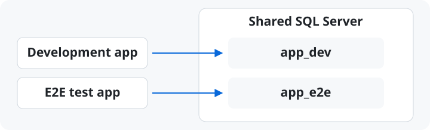

# E2E 測試

[English](./e2e-testing.md) · [繁體中文](./e2e-testing.zh-TW.md)

用 Orbit 啟動 E2E 測試需要的資料庫、快取和訊息服務。測試程式負責準備自己的資料，
並在執行前確認環境已就緒。

## 基礎設施與測試資料

把整個 stack 分成三層，各有各的擁有者：

| 層 | 擁有者 | 生命週期 |
|---|---|---|
| 基礎設施（database、cache、broker） | Orbit（`orbit up --infra`） | 長駐，與日常開發共用 |
| 測試資料（專屬的 database 或 schema） | 測試 harness | 可拋棄，scenario 之間重置 |
| 受測系統（app runtime） | 測試 harness | 每次執行以測試 profile 啟動 |

### 資料庫隔離



開發用程式連到 `app_dev`，測試設定連到 `app_e2e`。透過各自的連線設定指定
資料庫名稱。如果使用 SQL Project，將 `app_e2e` 設為 publish 目標，跑
`orbit sqlserver publish app_e2e` 後再建立測試資料。重設前先確認目標是
`app_e2e`，名稱不符就中止。兩套應用程式若同時運行，請各用一個 port。

本機 SQL Project 的 publish 方式見 [SQL Projects](sql-workflow.zh-TW.md)。

## 環境就緒檢查

`orbit switch` 會停掉運行中的資源並重啟 daemon。它是機器層級的 provisioning
步驟：放在 pipeline 的 setup 階段或由人親手輸入是對的，作為跑測試的隱式副作
用是錯的。Orbit 會強制這件事——有資源運行時，`switch` 會要求確認，非互動的
caller 必須加 `--yes`。

harness 應該做的是開跑前先*驗證*：

1. 讀 `orbit env info --json`。它回報 env 的身分，以及每個資源帶出處的 port
   與 URL——`declared` 來自 environment 檔、`observed` 來自運行中的 daemon。
   daemon 服務的是別的 environment 時不給 observed 值，harness 永遠不會把別
   的 stack 的 port 誤認成自己的。含憑證的 environment 值需要
   `--show-secrets` 才輸出。
2. 確認套件需要的資源存在且 healthy（完整生命週期細節在
   `orbit status --json`）。
3. 不滿足時快速失敗，並給出可執行的訊息——列出缺少的資源，印出人類（或
   pipeline 的 provisioning 階段）該執行的 `orbit switch <env>` / `orbit up`
   指令。不要自己執行它。

失敗時 `orbit up --json` 自帶證據：`data.failed_resources` 列出每個沒有變
healthy 的資源，含狀態、原因與有上限的 log tail。CI log 不需要第二個指令就能
看到解釋。payload 形狀見 [agent CLI contract](agent-cli.zh-TW.md)。

## Instances

專屬 runner 或 dev 環境旁的第二個 stack，請為該次執行指定唯一 named instance：

```bash
orbit up --instance ci-$BUILD_ID --infra --json
orbit status --instance ci-$BUILD_ID --json
# 使用上述 response 回報的 resolved endpoints 執行測試
orbit instance clean ci-$BUILD_ID --json
```

Named instance 會隔離 daemon state、Docker resources、volumes、networks 與 host
ports。宣告 ports 是 preferences；JSON response 會回報解析後的 endpoints，test
harness 必須使用它們，不能假設 environment 檔裡的 ports。整次執行的每個 Orbit
command 都要維持相同 `--instance` target，並在 suite 結束後清理。Ownership model
見[隔離的 runtime instances](instances.zh-TW.md)。

若 CI 的 Docker daemon 或 storage driver 無法穩定處理並行 image 解壓縮，請使用
[設定](configuration.zh-TW.md#settings)中的 pull 併發上限，而不必另外維護 image
預拉清單。
