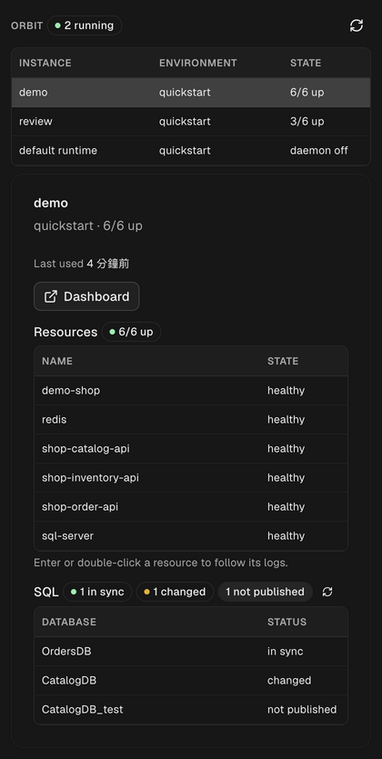

# Integrations

[English](./integrations.md) · [繁體中文](./integrations.zh-TW.md)

Tools built on Orbit's [JSON CLI contract](./agent-cli.md).

## Orbit for Orca

A read-only Orbit panel in [Orca](https://www.onorca.dev)'s sidebar: instances,
their containers and services, SQL sync status, and logs in a terminal tab.

Install: in Orca, open Settings → Plugins → Add → "From a Git URL…" and enter
`https://github.com/iml885203/orca-orbit`. Needs Orbit 0.16.10+ and Orca
1.4.247+. Details are in the [plugin repository](https://github.com/iml885203/orca-orbit).
