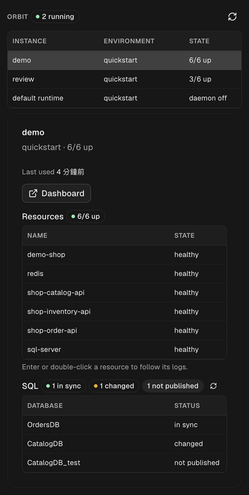
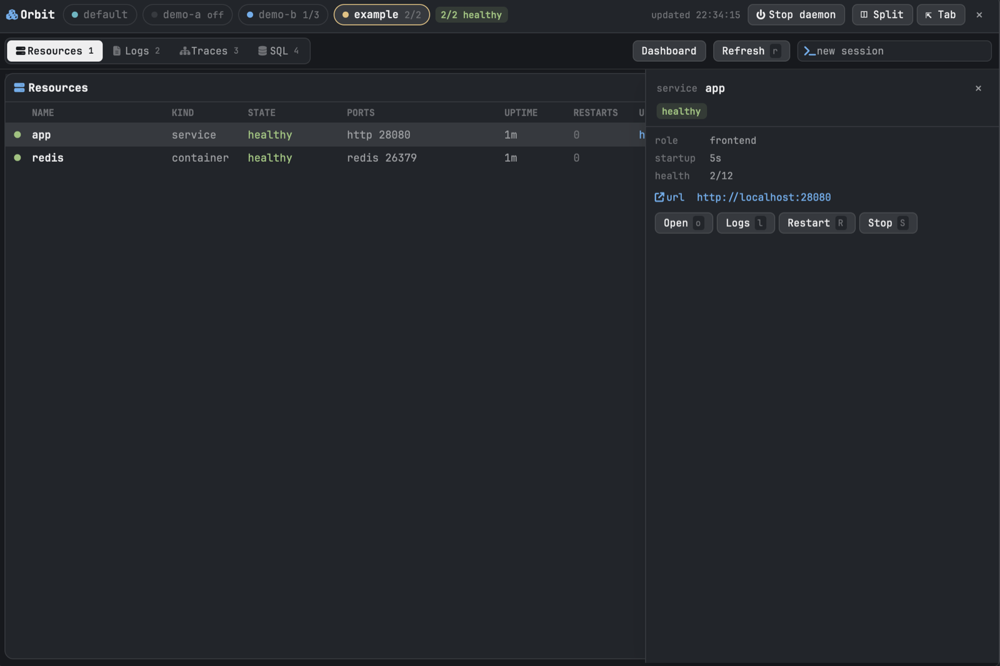

# 整合

[English](./integrations.md) · [繁體中文](./integrations.zh-TW.md)

建立在 Orbit [JSON CLI contract](./agent-cli.zh-TW.md) 上的工具。

## Orbit for Orca

在 [Orca](https://www.onorca.dev) sidebar 加入唯讀的 Orbit 面板：instances、其
containers 與 services、SQL 同步狀態，並可在 terminal 分頁開啟 logs。

安裝：在 Orca 開啟 Settings → Plugins → Add → "From a Git URL…"，輸入
`https://github.com/iml885203/orca-orbit`。需要 Orbit 0.16.10+ 與 Orca 1.4.247+。
詳細內容見 [plugin repository](https://github.com/iml885203/orca-orbit)。

## Orbit for Herdr app

[Herdr app](https://herdr.dev)（`herdr-app` 桌面 app，不是 Herdr terminal TUI）的
Orbit 視窗：每個 instance 一顆 pill、其 containers 與 services（可 restart、
stop）、logs、traces 與 span waterfall、SQL 同步狀態，以及停止 daemon 的按鈕。
logs 與 traces 可以交給 Herdr app terminal 裡的 coding agent。

安裝：Herdr app 的 mod 由 agent 加入，而不是透過套件管理。請 Herdr app 裡的
agent 從 `https://github.com/iml885203/orbit/tree/main/integrations/herdr-app`
加入這個 mod；它會讀過檔案、把 `mods/orbit/` 複製到
`~/.config/herdr-app/mods/`，並合併 `keys.json` 的 `cmd-o`。SQL 狀態需要
Orbit 0.16.10+。建置方式見 [RECIPE.md](https://github.com/iml885203/orbit/blob/main/integrations/herdr-app/RECIPE.md)。
