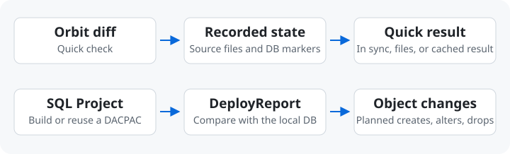
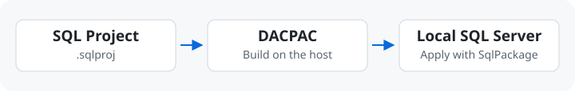

# SQL Projects

[English](./sql-workflow.md) · [繁體中文](./sql-workflow.zh-TW.md)

Orbit’s optional SQL Server workflow lets you preview and publish changes
from a SQL project (`.sqlproj`) to a local database. Use `diff` after a
pull, then `publish` when the local schema needs updating.

Enable `sqlserver` in your [environment configuration](configuration.md#sqlserver)
to use the workflow.

## Schema Diff



Pull the latest code, then run `orbit sqlserver diff AppDB`. If the quick
check lists a new `GetOrder.sql`, you know a source file changed since
the last publish. For the database impact, run
`orbit sqlserver diff AppDB --analyze`.

A full comparison prepares or reuses a DACPAC and runs SqlPackage
`/Action:DeployReport` to list what a publish would create, alter, or
drop. Orbit also takes this path when recorded state cannot answer the
check. Neither command changes the database.

## Publish



```sh
orbit sqlserver publish AccountsDev
```

Orbit blocks changes that may lose data by default. Check the impact with
`diff` before applying them.

::: details Configuration and prerequisites

Set the SQL Server container and projects in `orbit.yaml`. The host needs
SqlPackage and, for source builds, the .NET SDK. Run `orbit doctor` to check.

```yaml
sqlserver:
  target: database
  username: sa
  password_env: MSSQL_SA_PASSWORD
  projects:
    - path: database/Accounts/Accounts.sqlproj
      databases: [AccountsDev, AccountsE2E]
    - path: database/Orders/Orders.sqlproj
```

`target` names the SQL Server container. Each `path` is relative to the
workspace. The project filename supplies the default database name. If you
set `databases`, give at least one name and map each name to one project.
The DACPAC must match the `.sqlproj` basename, including projects that set
`SqlTargetName`.

:::

::: details JSON and changes that may lose data

Add `--json` for ordinary publishes. Success lists the published databases.
Changes that may lose data require confirmation with `--allow-data-loss`.
In JSON mode, Orbit reports a manual command with the selected scope and
`--allow-data-loss`, leaving out `--yes` so a person can review the change.
For automation, use `--yes` only after reviewing the impact and target.

:::

### Batch Publish

`orbit sqlserver publish --all` publishes every database from the project merge
sequentially, stopping at the first failure. Add `--parallel[=N]` to publish
up to N databases concurrently. The dashboard's `Publish all` button does the
same through the daemon.

**`--parallel` needs an already-provisioned server.** Creating databases for
the first time deploys shared server-level objects — logins and roles the
projects have in common — and concurrent publishes race to create the same
ones, so all but the first fail with `Msg 15025: The server principal '<name>'
already exists`. Publishing sequentially the first time and reusing that
server afterwards avoids it; a workflow that provisions a fresh container per
run should stay sequential.

Against an empty SQL Server, the same command creates missing databases and
deploys referenced shared objects. Rerun it after fixing a failed project;
successful databases converge to no-ops.

### Prebuilt DACPACs

Use `--dacpac-dir <root>` with `publish`, `diff`, or `reset` when the current
runner already has build artifacts:

```bash
orbit sqlserver publish --all --dacpac-dir .artifacts
```

The environment still declares each `.sqlproj`; its basename identifies the
artifact directory and leaf dacpac. For example, `db/PlatformDB.sqlproj` uses:

```text
.artifacts/
  PlatformDB/
    PlatformDB.dacpac
    CommonFiles.dacpac
```

Keep every referenced dacpac beside the leaf. Orbit copies the complete set to
operation-local scratch space and logs each file's size and modification time.
The supplied root, project directory, and expected leaf must all exist and use
the exact case of the `.sqlproj` basename. With
`--all`, Orbit validates every project before publishing and never falls back
to `dotnet build` for a missing artifact.

This mode still requires sqlpackage, but not the .NET SDK or a readable source
tree. Without sources, source-based fast diff and publish-state recording are
unavailable; diff uses the deployment engine and a later run does not assume
the artifact is unchanged.

Doctor treats missing project sources and the SDK as warnings because prebuilt
artifacts can replace both. Missing sqlpackage remains a failed prerequisite.

`password_env` names the target container key containing the password. Orbit
reads that resolved value only when a DB operation runs and never exposes it
in status, logs, or JSON output.

### Reset

`orbit sqlserver reset <db>` disconnects active clients, discards local data, and
applies the latest schema. No setup command is required. Orbit automatically
chooses a fast restore when available. Without a baseline, reset drops and
recreates the whole database before publishing the SQL project; the prompt
states which path will run before any data is removed.

`orbit sqlserver query` is intentionally CLI-only. The dashboard focuses on project
drift, publish, and reset operations rather than embedding a general SQL
console.

## Persistence

The environment config should mount persistent storage at `/var/opt/mssql`,
where SQL Server writes its `.mdf` / `.ldf` files. With that mount, your
accumulated schema and data are preserved
across:

- `orbit restart <sqlserver.target>`
- Docker daemon restarts
- Host reboots
- `orbit down` followed by `orbit up`

Orbit never removes that storage automatically. Removing its volume or bind
mount data permanently deletes every local database. Use `orbit sqlserver reset
<dbname>` when only one database needs clean data.

A fresh volume starts empty; `orbit sqlserver publish --all` creates and publishes
every configured database.

## Commands

| Situation | Command | Cost |
|---|---|---|
| Check whether source changed | `orbit sqlserver diff <dbname>` | usually under a second |
| You just changed one stored proc / table | `orbit sqlserver publish <dbname>` | ~15s, idempotent, no downtime |
| You merged schema from `main` and want it locally | `orbit sqlserver publish <dbname>` (or `--all`) | ~15s per DB, data preserved |
| The live DB is full of bad test data | `orbit sqlserver reset <dbname>` | seconds, local data discarded |
| Set up a fresh SQL Server | `orbit sqlserver publish --all` | creates and publishes every configured DB |

## Dashboard

The SQL Server page checks source changes when opened or focused. Each database
shows whether it is in sync and provides Check, Publish, and Reset actions.

### Dashboard Publish

The SQL Server page has per-db Publish and Reset buttons plus Publish all.
Publish streams its output in a log panel; Reset always prompts before
discarding local data. When no reset point exists yet, the page explains
beforehand that the first reset recreates the database and saves one for later.

Only one db operation can run at a time across the daemon — the buttons disable
while another op is in flight. When publish detects possible data loss, it is
blocked until the user reviews the warning and explicitly confirms the
force-publish action.

## See Also

- [configuration.md](configuration.md#sqlserver) — complete target container and `sqlserver` configuration
- [docs/troubleshooting.md](troubleshooting.md) — broader error catalog
