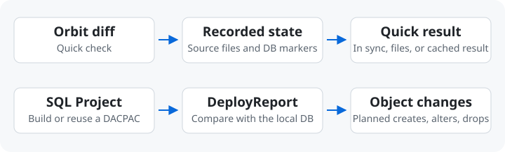
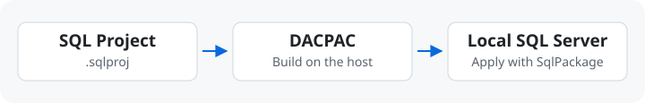

# SQL Projects

[English](./sql-workflow.md) · [繁體中文](./sql-workflow.zh-TW.md)

Orbit 的選用 SQL Server 功能讓你預覽 SQL Project（`.sqlproj`）的變更，
再套用到本機資料庫。Pull 後先跑 `diff`，需要更新本機結構時再跑 `publish`。

在[環境設定](configuration.zh-TW.md#sqlserver)啟用 `sqlserver` 即可使用。

## Schema Diff



Pull 後先跑 `orbit sqlserver diff AppDB`。例如，快速檢查列出新增的
`GetOrder.sql`，就知道上次 publish 後有來源檔案變更。要看資料庫會受什麼
影響，再跑 `orbit sqlserver diff AppDB --analyze`。

完整比對會準備或重用 DACPAC，再用 SqlPackage `/Action:DeployReport` 列出
publish 預計建立、修改或刪除的物件。紀錄不足以判定時，Orbit 也會走這條路。
這兩個指令都不會修改資料庫。

## Publish



```sh
orbit sqlserver publish AccountsDev
```

Orbit 預設擋下可能造成資料遺失的變更。先用 `diff` 檢查影響，再決定是否套用。

::: details 設定與前置需求

在 `orbit.yaml` 指定 SQL Server 容器和要部署的專案。主機需要 SqlPackage，從原始碼建置時也需要 .NET SDK。用 `orbit doctor` 檢查。

```yaml
sqlserver:
  target: database
  username: sa
  password_env: MSSQL_SA_PASSWORD
  projects:
    - path: database/Accounts/Accounts.sqlproj
      databases: [AccountsDev, AccountsE2E]
    - path: database/Orders/Orders.sqlproj
```

`target` 是 SQL Server 容器名稱。`path` 相對於工作區。未設定 `databases`
時，Orbit 用專案檔名作為資料庫名稱。明確指定時至少要有一個名稱，每個名稱只能對應一個專案。
DACPAC 必須沿用 `.sqlproj` 檔名，包含設定了 `SqlTargetName` 的專案。

:::

::: details JSON 與可能遺失資料的變更

一般部署可加 `--json`，成功時會列出已部署的資料庫。
可能遺失資料的變更需用 `--allow-data-loss` 確認。JSON 模式會回報需人工執行的
指令，保留原本的部署範圍與 `--allow-data-loss`，不會替你加 `--yes`。
自動化若需要 `--yes`，請先確認變更與目標。

:::

### 批次 Publish

`orbit sqlserver publish --all` 依 project merge 順序逐顆 publish 所有資料庫,
遇到第一個失敗即停止。加上 `--parallel[=N]` 可同時 publish 最多 N 顆。
Dashboard 的 `Publish all` 按鈕透過 daemon 做同一件事。對空的 SQL Server
執行時，同一個指令會建立缺少的資料庫並部署 referenced shared objects。
修好失敗的 project 後直接重跑；已成功的資料庫會收斂為 no-op。

**`--parallel` 需要已建置過的 server。** 首次建立資料庫時會部署 server 層級的
shared objects——各 project 共用的 login 與 role——而並行的 publish 會競相建立
同一批，於是除了第一個以外全部失敗，錯誤是
`Msg 15025: The server principal '<name>' already exists`。第一次用序列 publish、
之後沿用同一台 server 就不會遇到；每次都開全新容器的流程請維持序列。

### 預建 DACPAC

runner 已取得 build artifacts 時，可在 `publish`、`diff` 或 `reset` 加上
`--dacpac-dir <root>`：

```bash
orbit sqlserver publish --all --dacpac-dir .artifacts
```

環境仍宣告 `.sqlproj`；檔名會決定 artifact 目錄與 leaf dacpac。例如
`db/PlatformDB.sqlproj` 使用：

```text
.artifacts/
  PlatformDB/
    PlatformDB.dacpac
    CommonFiles.dacpac
```

所有 referenced dacpac 必須與 leaf 放在一起。Orbit 會把整組檔案複製到
該次 operation 的暫存目錄，並記錄每個檔案的大小與修改時間。提供的 root、
project 目錄與預期 leaf 都必須存在，且大小寫必須與 `.sqlproj` basename
完全一致。搭配 `--all` 時，Orbit 會在發佈前先
驗證所有 project；缺 artifact 時不會偷偷改跑 `dotnet build`。

此模式仍需要 sqlpackage，但不需要 .NET SDK 或可讀取的 source tree。沒有
source 時，source-based fast diff 與 publish-state 記錄不可用；diff 會使用
deployment engine，後續執行也不會假設 artifact 沒有變更。

Doctor 會把缺少 project source 與 SDK 視為 warning，因為預建 artifacts 可
取代兩者；缺少 sqlpackage 仍會判定為前置需求失敗。

`password_env` 指定 target container 裡存放密碼的 key。Orbit 只在 DB
操作執行時讀取解析後的值，不會在 status、logs 或 JSON output 暴露密碼。

### Reset

`orbit sqlserver reset <db>` 會中斷現有連線、丟棄本機資料並套用最新 schema。
不需要先執行任何設定指令。Orbit 有可用的快速還原狀態時會直接使用，否則
會先 drop 並重建整顆 database，再 publish SQL project。移除任何資料前，
確認提示會明確說明將執行哪一條路徑。

`orbit sqlserver query` 刻意只提供 CLI 操作。Dashboard 專注於 project drift、
publish 與 reset，而不內嵌通用 SQL console。

## 持久化

環境設定應把持久化儲存空間掛在 `/var/opt/mssql`；SQL Server 會在那裡寫入
`.mdf` / `.ldf` 檔案。有這個 mount 時，你累積的 schema 與資料會在以下
情境之間保留：

- `orbit restart <sqlserver.target>`
- Docker daemon 重啟
- 主機重新開機
- `orbit down` 之後再 `orbit up`

Orbit 不會自動移除該儲存空間。刪除 volume 或 bind mount 內的資料會永久
刪除所有本機資料庫；只有一顆 database 需要乾淨資料時，請使用
`orbit sqlserver reset <dbname>`。

全新的 volume 一開始是空的；`orbit sqlserver publish --all` 會建立並 publish
所有設定好的資料庫。

## 指令

| 情境 | 指令 | 成本 |
|---|---|---|
| 想知道 SQL source 有沒有變更 | `orbit sqlserver diff <dbname>` | 通常不到一秒 |
| 你剛改了一支 stored proc / 一張 table | `orbit sqlserver publish <dbname>` | 約 15 秒，冪等，沒有 downtime |
| 你從 `main` merge 了 schema，想在本地套用 | `orbit sqlserver publish <dbname>`（或 `--all`） | 每個 DB 約 15 秒，資料保留 |
| DB 塞滿不要的測試資料 | `orbit sqlserver reset <dbname>` | 幾秒，丟棄本機資料 |
| 初始化全新的 SQL Server | `orbit sqlserver publish --all` | 建立並 publish 所有 DB |

## Dashboard

SQL Server 頁面會在進入或回到視窗時檢查 source 變更。每顆資料庫都會顯示
是否同步，並提供 Check、Publish 與 Reset。

### Dashboard Publish

SQL Server 頁面為每個 db 提供 Publish 與 Reset，並提供 Publish all。
Publish 的串流輸出顯示在 log panel；Reset 丟棄資料前一定會要求確認。尚未有
reset point 時，頁面會先說明第一次 reset 將重建資料庫，並為之後保存 reset
point。

整個 daemon 一次只能跑一個 db operation —— 當另一個 op 進行中時按鈕
都會停用。Publish 偵測到可能資料遺失時會先阻擋；使用者檢視警告並明確
確認後，才能執行 force publish。

## 延伸閱讀

- [configuration.zh-TW.md](configuration.zh-TW.md#sqlserver) —— 完整的 target container 與 `sqlserver` 設定
- [troubleshooting.zh-TW.md](troubleshooting.zh-TW.md) —— 更完整的錯誤列表
