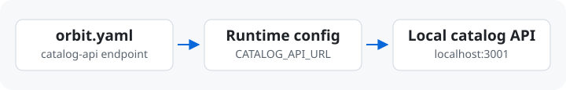

# Team Adoption

[English](./team-adoption.md) · [繁體中文](./team-adoption.zh-TW.md)

Get one environment working on your machine, then have a teammate reproduce it
from a fresh checkout. Start with the services needed for one development task.

## First YAML

Save an `orbit.yaml` beside a project and describe its startup command, port,
and dependencies. For a first try without an app, put this example in an empty
folder with Python 3 installed. Run the commands from that folder.

```yaml
version: "3"
services:
  app:
    kind: frontend
    command: python3 -m http.server "$PORT"
    ports:
      http: 28080
```

```sh
orbit doctor
orbit up
orbit open app
```

When the browser opens the local server, the YAML is working. Run `orbit down`
when finished. For a real project, start with one endpoint you can test, then
add the containers or services it needs. See the [local-first guide](local-first.md)
for the onboarding prompt.

## Runtime Configuration



A service that always calls a staging URL still calls staging when you start
it locally. Make that URL configurable so the same code can use a local service
on your machine and the staging service after deployment.

| What to configure | What to verify locally |
| --- | --- |
| Listen port | The app binds to Orbit's `$PORT`, as in the first YAML. |
| Service or SDK endpoint | The app or SDK reads an override such as `CATALOG_API_URL`. Orbit can provide it when the app declares `depends_on: [catalog-api]` and that service has an HTTP endpoint. |
| Database connection and test data | The app accepts a local connection string. Publish the schema and seed a named test database before exercising a flow that uses it. |

Run one request that uses the dependency and verify it reaches the local
instance. For database setup, see [SQL Server Database Projects](sql-workflow.md)
and [E2E testing](e2e-testing.md).

## Environment Repository

For one app repo, commit the working `orbit.yaml` alongside the app. A teammate
can check it out and repeat the same commands. For a stack that spans several
repos, put the environment in a shared Git repo as `envs/dev.yaml`. Use paths
such as `path: ${WORKSPACE_ROOT}/api` and tell teammates which repos to check out
under that workspace. Keep credentials in each developer's local configuration.

From the workspace root, select the shared environment and verify the project
paths. Use a directory with no project-local `orbit.yaml` in it or its parents,
since Orbit checks that file first.

```sh
orbit init --source team --url https://github.com/example/team-envs.git --env dev
orbit env info
orbit doctor
orbit up
```

Replace the example URL with the team repo. Confirm `orbit env info` shows
`team/dev`, then repeat the browser or API check.
See [environment sources](environment-sources.md) for maintaining the shared
repo and rolling out updates.
