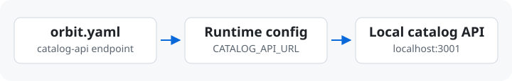

# 團隊導入

[English](./team-adoption.md) · [繁體中文](./team-adoption.zh-TW.md)

先在自己的電腦跑通一套環境，再請隊友從新的 checkout 重跑。第一套環境只需要
涵蓋一項開發任務會用到的服務。

## 第一份 YAML

在專案旁建立 `orbit.yaml`，寫下啟動指令、port 和需要的相依服務。如果想先試
Orbit，可以在裝有 Python 3 的電腦上開一個空資料夾，把以下設定存成
`orbit.yaml`，再從同一個資料夾執行指令。

```yaml
version: "3"
services:
  app:
    kind: frontend
    command: python3 -m http.server "$PORT"
    ports:
      http: 28080
```

```sh
orbit doctor
orbit up
orbit open app
```

瀏覽器能開啟本機服務，就跑通了第一份 YAML。試完用 `orbit down` 關閉環境。
換成自己的專案時，先挑一個能驗證的端點，再加入它需要的容器和服務。
想請 Agent 幫忙，可以從[本機入門指南](local-first.zh-TW.md)的 prompt 開始。

## 執行環境設定



如果程式把服務網址寫死在 staging，即使在本機啟動，請求還是會送到 staging。
把網址改成啟動時可設定，同一份程式碼就能在本機連本機服務，部署後連 staging。

| 要能設定什麼 | 怎麼驗證 |
| --- | --- |
| 監聽 port | 讓程式使用 Orbit 傳入的 `$PORT`，就像第一份 YAML。 |
| 服務或 SDK 端點 | 讓程式或 SDK 讀取 `CATALOG_API_URL` 這類覆寫值。若程式宣告 `depends_on: [catalog-api]`，且該服務有 HTTP 端點，Orbit 可以傳入解析後的 URL。 |
| 資料庫連線與測試資料 | 讓程式接受本機連線字串。先把 schema 和測試資料準備到指定的測試 DB，再跑會用到它的流程。 |

實際跑一次會呼叫相依服務的請求，確認它有打到本機。資料庫設定可接著看
[SQL Server Database Projects](sql-workflow.zh-TW.md)和 [E2E 測試](e2e-testing.zh-TW.md)。

## 環境 Repo

如果只有一個應用程式 repo，把跑通的 `orbit.yaml` 跟程式碼一起提交。隊友 checkout
後就能重跑相同指令。如果環境跨多個 repo，可以建一個共享的 Git repo，把設定存成
`envs/dev.yaml`。用 `path: ${WORKSPACE_ROOT}/api` 這類路徑，並寫清楚隊友需要
把哪些 repo 放在工作區底下。憑證留在各自的本機設定。

隊友從工作區根目錄選擇共享環境。執行指令的目錄與上層目錄都應沒有專案的
`orbit.yaml`，因為 Orbit 會優先讀取這份檔案。

```sh
orbit init --source team --url https://github.com/example/team-envs.git --env dev
orbit env info
orbit doctor
orbit up
```

將範例 URL 換成團隊 repo。確認 `orbit env info` 顯示 `team/dev` 後，請隊友重跑
瀏覽器操作或 API 請求。共享 repo 之後怎麼維護和更新，
可以接著看[環境來源](environment-sources.zh-TW.md)。
