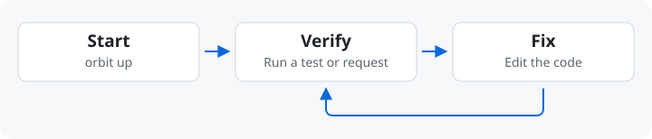
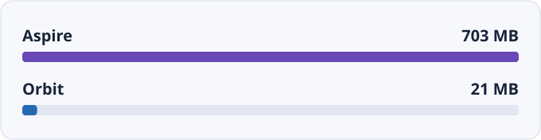

# Why Orbit?

[English](./why-orbit.md) · [繁體中文](./why-orbit.zh-TW.md)

Orbit runs the services and containers you need to verify a change locally.
Describe the environment in `orbit.yaml` so developers and coding agents can
start the same stack and check the same results.

## Local Verification

Run `orbit up` to start dependencies and wait for readiness. Run a test or
send a request. If it fails, inspect the service logs or trace, fix the code,
and run the check again in the same environment.

Use the Dashboard to inspect services. Give an agent the [CLI](agent-cli.md)
to read status and logs from the same daemon.

## Environments

Start with one `orbit.yaml` beside your code. Add the service commands, ports,
and containers needed for the task. For another task, select the environment
that describes its services. When the setup works, share the YAML with the
team.

[First YAML](local-first.md) · [Team adoption](team-adoption.md) ·
[Environment sources](environment-sources.md)

## SQL Projects and E2E

- [SQL Projects](sql-workflow.md): check what changed after a pull and publish
  the schema to your local SQL Server before testing.
- [E2E Testing](e2e-testing.md): share infrastructure with development while
  keeping test data in its own database.

## Benchmarks

In one eShop comparison on macOS, Orbit used **21 MB** and Aspire used
**703 MB** of memory for the orchestration tools, excluding the application
services and containers. See the [eShop benchmark](benchmarks.md) for the
measurement scope and limits.

## Comparisons

| Tool | Workflow |
| --- | --- |
| Docker Compose | Define and run a containerized stack. |
| Aspire | Describe a distributed application in an AppHost and use the model across development and deployment. |
| Orbit | Describe local host processes and containers in YAML, then operate them from the CLI or Dashboard. |

Orbit's scope is local development and testing. Keep your application startup
commands and existing deployment pipeline.
