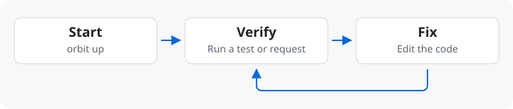
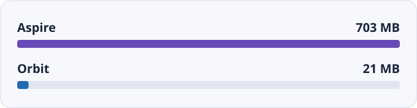

# 為什麼選擇 Orbit

[English](./why-orbit.md) · [繁體中文](./why-orbit.zh-TW.md)

Orbit 啟動驗證變更所需的本機服務和容器。把環境寫進 `orbit.yaml`，
開發者和 Agent 就能啟動同一套環境、檢查同樣的結果。

## 本機驗證

用 `orbit up` 啟動相依服務並等待就緒，接著跑測試或送出請求。遇到失敗，
先看服務的 log 或 trace，修正程式碼後在同一套環境再驗一次。

開發者可以在 Dashboard 看服務狀態。Agent 可以透過 [CLI](agent-cli.zh-TW.md)
讀取同一個 daemon 的狀態和 log。

## 環境

先在專案旁建立一份 `orbit.yaml`，寫下這項任務需要的服務指令、port 和容器。
換任務時，選擇對應的環境。跑通之後，把 YAML 分享給隊友。

[第一份 YAML](local-first.zh-TW.md) · [團隊導入](team-adoption.zh-TW.md) ·
[環境來源](environment-sources.zh-TW.md)

## SQL Projects 與 E2E

- [SQL Projects](sql-workflow.zh-TW.md) — Pull 後先查變更，再把 schema 更新到本機 SQL Server。
- [E2E 測試](e2e-testing.zh-TW.md) — 共用開發用的基礎設施，測試資料放在自己的資料庫。

## 效能量測

一次 macOS 的 eShop 比較中，Orbit 使用 **21 MB**，Aspire 使用 **703 MB**。
這組數字只計環境管理工具，排除應用程式服務和容器。
量測範圍與限制請見 [eShop Benchmark](benchmarks.zh-TW.md)。

## 工具比較 {#比較}

| 工具 | 適用流程 |
| --- | --- |
| Docker Compose | 定義並啟動容器化環境。 |
| Aspire | 透過 AppHost 描述分散式應用，將同一份模型用於開發和部署。 |
| Orbit | 用 YAML 描述本機程序和容器，再用 CLI 或 Dashboard 操作。 |

Orbit 專注在本機開發與測試。你可以沿用原有的啟動指令和部署流程。
